# SentinelOps

**A self-defending, cost-aware DevSecOps platform**: *Secure CI/CD Pipeline for Containerized
Applications with AWS* (SRM Institute of Science & Technology, B.Tech CSE Cloud Computing).

[](https://github.com/rohan-0024/sentinelops/actions/workflows/verify.yml)


Manual deployment is slow, error-prone and insecure. SentinelOps takes a commit from GitHub to
a **signed, risk-scored, canary-deployed and chaos-tested** release on Kubernetes in about five
minutes. It **refuses** to ship anything that leaks a secret, carries a fixable critical CVE,
runs as root or is unsigned, and it **rolls itself back** when a release breaks its SLO.

```
GitHub → Jenkins → gitleaks → tests → SonarQube → checkov → Docker → Trivy → SBOM → Risk Score
       → Registry (ECR) → Cosign → Kyverno → Argo Rollouts canary → smoke + chaos → Prometheus/Grafana
```

## Architecture

```mermaid
flowchart LR
  dev([Developer]) -->|git push| gh[(GitHub)]
  gh -->|poll / webhook| jk

  subgraph CI["Jenkins pipeline (13 stages)"]
    direction TB
    jk[1 gitleaks] --> t[2 pytest ≥80%] --> sq[3 SonarQube gate] --> ck[4 checkov + Infracost]
    ck --> db[5 docker build] --> tv[6 Trivy gate] --> sb[7 Syft SBOM] --> drs{8 Risk Score}
    drs -->|"≤ 60"| push[9 push by digest] --> sign[10 Cosign sign + attest]
    drs -->|"> 60"| blk([blocked])
  end

  sign --> reg[(Registry / Amazon ECR)]
  sign --> dep[11 Helm → Argo Rollout]

  subgraph K8S["Kubernetes (kind locally / Amazon EKS)"]
    direction TB
    kv[Kyverno admission: signature, attestations, digest, non-root] --> ro[Canary 10% → 50% → 100%]
    ro <-->|AnalysisRun: error rate, p95| prom[(Prometheus)]
    prom --> graf[Grafana Command Center]
    prom --> am[Alertmanager → Telegram / Slack]
  end

  dep --> kv
  reg -.->|pull| kv
  ro --> chaos[12 smoke + chaos gate]
  chaos --> pg[13 Pushgateway: DORA, DRS, chaos]
  pg --> prom
  CI -.->|on failure| ex[AI failure explainer] -.-> am
```



More diagrams (pipeline sequence, canary state machine, AWS topology) are in
[docs/ARCHITECTURE.md](docs/ARCHITECTURE.md).

## What makes it different
| # | Feature | How it works | Proof |
|---|---|---|---|
| 1 | **Deployment Risk Score** | `tools/drs` turns Trivy, SonarQube, checkov, gitleaks and coverage into a transparent 0-100 score (weights in `policy/risk.yaml`). Below 30 it deploys with short canary pauses, 30-60 with long ones, and above 60 it blocks. | Stage 8 → `drs.md`; build #28: **54.0 → canary** |
| 2 | **Zero-trust supply chain** | Syft SBOM, Cosign signature, and SBOM + vulnerability attestations. Kyverno admits only signed, attested, digest-pinned, non-root images from the trusted registry. | `make demo-supply-chain` 4/4 · [docs/SLSA.md](docs/SLSA.md) |
| 3 | **Self-healing canary** | Argo Rollouts 10 → 50 → 100 % with Prometheus analysis (error rate ≤ 5 %, p95 ≤ 300 ms). A breach aborts and rolls back with no human action, plus multi-window burn-rate alerts. | `make demo-canary`: aborted after 3 failed checks |
| 4 | **Chaos gate** | After each deploy it kills 30 % of pods under CPU stress. The build passes only if the app recovers in ≤ 60 s with ≥ 95 % probe success. | Build #28: recovered in **9.7 s**, 149 probes at 100 % |
| 5 | **AI failure explainer** | Redacts secrets from the failing log, asks Claude for root cause and fix (rule engine when no key is set), and posts a "Why:" line to chat. | `explain.md` on every failed build |
| 6 | **FinOps autopilot** | Infracost per build. A Lambda + EventBridge schedule scales EKS nodes to 0 and stops Jenkins at 20:00 IST, with an SSM override. Same logic runs locally. | [docs/COST-REPORT.md](docs/COST-REPORT.md) |
| 7 | **DevSecOps Command Center** | Grafana dashboards as code: DORA, DRS trend, CVEs, Kyverno, canary, chaos, SLO/error budget, node health. | Grafana → *SentinelOps* folder |
| ⚔ | **Attack mode** | `make demo-attack` tries a hardcoded key, a vulnerable dependency, a root container and an unsigned image, and every gate stops them. `make demo-fix` restores and re-proves the baseline. | 6/6 blocked, 5/5 clean · [docs/DEMO.md](docs/DEMO.md) |

## Quick start (local mode, zero cost)
Requirements: Windows + WSL2 Ubuntu (or Linux/macOS), Docker Desktop, 16 GB RAM, ~25 GB disk.
Clone into the Linux filesystem (`~/sentinelops`, not `/mnt/c/...`).

```bash
git clone https://github.com/rohan-0024/sentinelops.git ~/sentinelops && cd ~/sentinelops
make tools          # pinned kind, kubectl, helm, terraform, trivy, cosign, gitleaks... into ./.bin
make init-env       # .env with generated passwords (git-ignored)
make local-up       # registry, SonarQube, Jenkins, kind + Prometheus/Grafana/Argo/Kyverno (~15 min first time)
make verify         # lint, tests, coverage, IaC scans, policy tests, promtool, helm lint
```
Then open Jenkins → **SentinelOps → main → Build Now**.

| Service | URL | Login |
|---|---|---|
| Jenkins | http://localhost:8080 | `admin` / `JENKINS_ADMIN_PASSWORD` in `.env` |
| SonarQube | http://localhost:9000 | `admin` / `SONAR_ADMIN_PASSWORD` in `.env` |
| Grafana | http://localhost:30300 | `admin` / `GRAFANA_ADMIN_PASSWORD` in `.env` |
| Prometheus | http://localhost:30090 | none |
| App | http://localhost:30080/health | none |
| Argo Rollouts | `make rollouts-dashboard` → http://localhost:3100 | none |

`make local-down` stops everything and keeps data; `make local-clean` also deletes volumes.

## AWS mode
Terraform in `terraform/envs/aws` creates the VPC, EKS 1.35 (SPOT t3.medium nodes), ECR, the
Jenkins + SonarQube EC2 (configured by Ansible), the FinOps Lambda, and S3 + DynamoDB remote
state. `lab_mode = true` (default) reuses the AWS Academy `LabRole`; `lab_mode = false` creates
dedicated IAM roles and IRSA for a standard account.

```bash
# AWS Academy: paste the session credentials into ~/.aws/credentials (never into the repo or chat)
make aws-bootstrap-plan && make aws-bootstrap   # state bucket + lock table (asks you to type APPLY)
make aws-plan                                   # creates NOTHING; prints the plan (+ Infracost)
make aws-apply                                  # billable: applies the saved plan after you type APPLY
make ansible-inventory && make ansible-aws      # configure Jenkins/SonarQube on the EC2 host
make aws-destroy                                # after the demo (type DESTROY)
```
> `terraform apply` never runs without an explicit, typed confirmation. A demo day (apply →
> 4 h → destroy) costs about $1-1.50; see [docs/COST-REPORT.md](docs/COST-REPORT.md).

## Repository layout
| Path | Contents |
|---|---|
| [`app/`](app) | FastAPI service (`/health`, `/ready`, `/metrics`, items API, fault injection), 18 tests, 98.9 % coverage |
| [`docker/`](docker) | Multi-stage build → distroless, non-root (UID 65532); read-only root FS enforced in the pod spec |
| [`jenkins/`](jenkins) | Declarative Jenkinsfile (13 stages), shared library, JCasC, custom Jenkins image |
| [`terraform/`](terraform) | Modules `vpc`, `eks`, `ecr`, `iam`, `jenkins-ec2`, `state-backend`, `finops`; roots `envs/aws`, `envs/local` (LocalStack), `bootstrap` |
| [`ansible/`](ansible) | Roles `hardening`, `docker`, `node_exporter`, `trivy`, `sonarqube`, `jenkins` + Molecule test |
| [`k8s/`](k8s) | App Helm chart (Argo Rollout, AnalysisTemplate, PodMonitor, NetworkPolicy, PDB), Kyverno policy chart, add-on values, kind config |
| [`monitoring/`](monitoring) | SLO definition, recording/alerting rules + promtool tests, Grafana dashboards (JSON) |
| [`policy/`](policy) | `risk.yaml` (DRS weights), Rego guardrails for DRS reports and Helm values (+ tests) |
| [`tools/`](tools) | Python CLIs: `drs`, `chaos`, `explain`, `finops`, `monitoring` (82 tests) |
| [`scripts/`](scripts) | Bash behind every Makefile target |
| [`docs/`](docs) | Architecture, threat model, SLSA, runbook, cost report, demo, viva Q&A, report outline, traceability |

`make help` lists every target.

## Documentation
| Document | Purpose |
|---|---|
| [ARCHITECTURE.md](docs/ARCHITECTURE.md) | Diagrams and design decisions |
| [THREAT-MODEL.md](docs/THREAT-MODEL.md) | STRIDE analysis mapped to controls |
| [SLSA.md](docs/SLSA.md) | Supply-chain levels: what is met and what is not |
| [RUNBOOK.md](docs/RUNBOOK.md) | One section per alert + day-2 operations |
| [COST-REPORT.md](docs/COST-REPORT.md) | Cost model, controls, FinOps autopilot |
| [DEMO.md](docs/DEMO.md) | 10-minute live demo script |
| [VIVA-QA.md](docs/VIVA-QA.md) | 30 likely viva questions with answers |
| [REPORT-OUTLINE.md](docs/REPORT-OUTLINE.md) | Chapter plan for the project report |
| [SCREENSHOTS.md](docs/SCREENSHOTS.md) | Evidence checklist for the report |
| [TRACEABILITY.md](docs/TRACEABILITY.md) | Requirement / slide topic → files → evidence |
| [PROGRESS.md](docs/PROGRESS.md) | Phase log: what was verified, where |
| [ASSUMPTIONS.md](docs/ASSUMPTIONS.md) | Assumptions and design decisions |
| [SECURITY-NOTES.md](docs/SECURITY-NOTES.md) | Incidents and pinning decisions (e.g. the Trivy release incident) |

## Security rules this repo follows
No secrets in git (gitleaks in Jenkins, in GitHub Actions and in `make secrets-scan`); every tool,
chart, image and Python dependency is pinned (`versions.env`, `requirements*.txt`, digests);
images are deployed by digest only; `terraform apply` requires a saved plan and typed confirmation.
