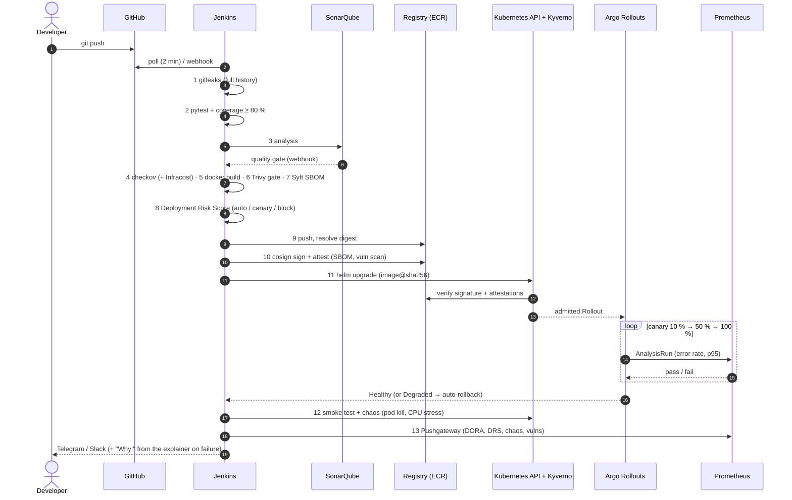
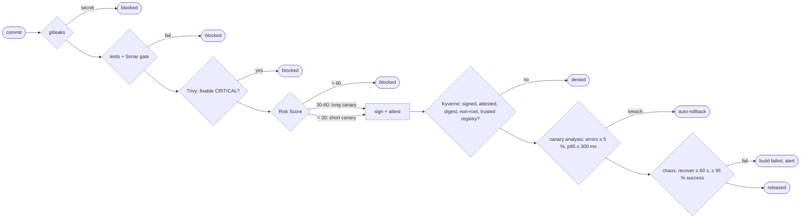
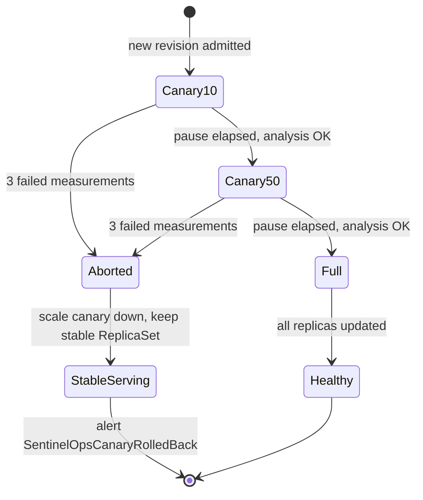
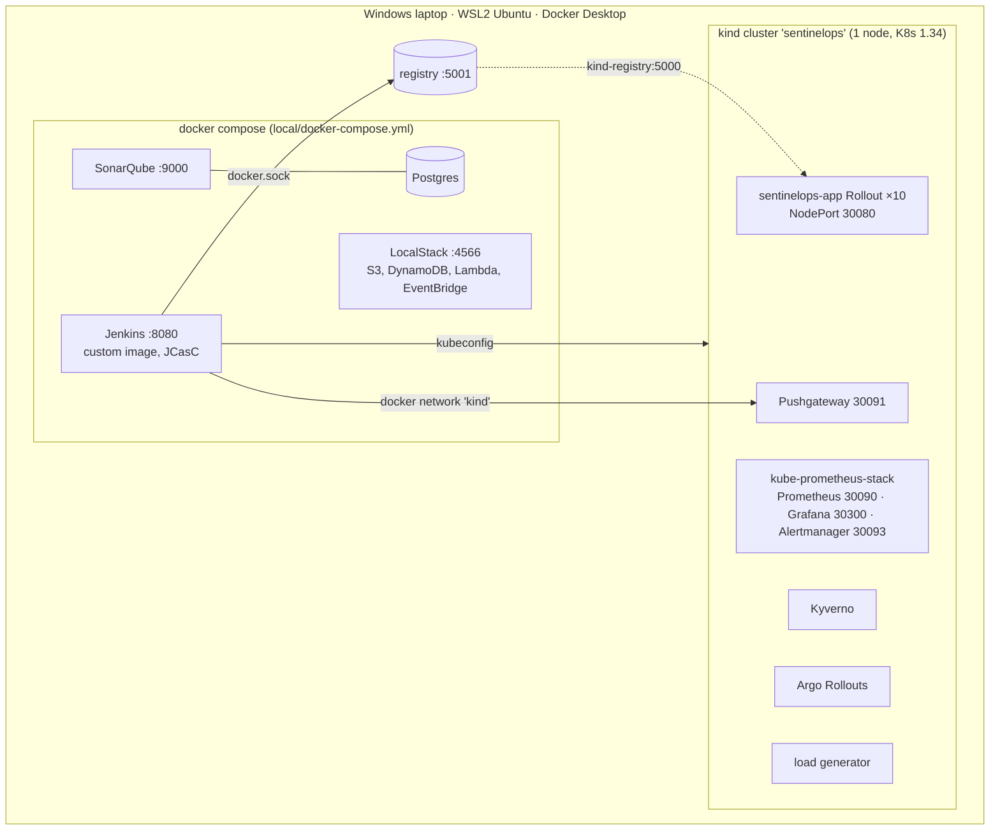
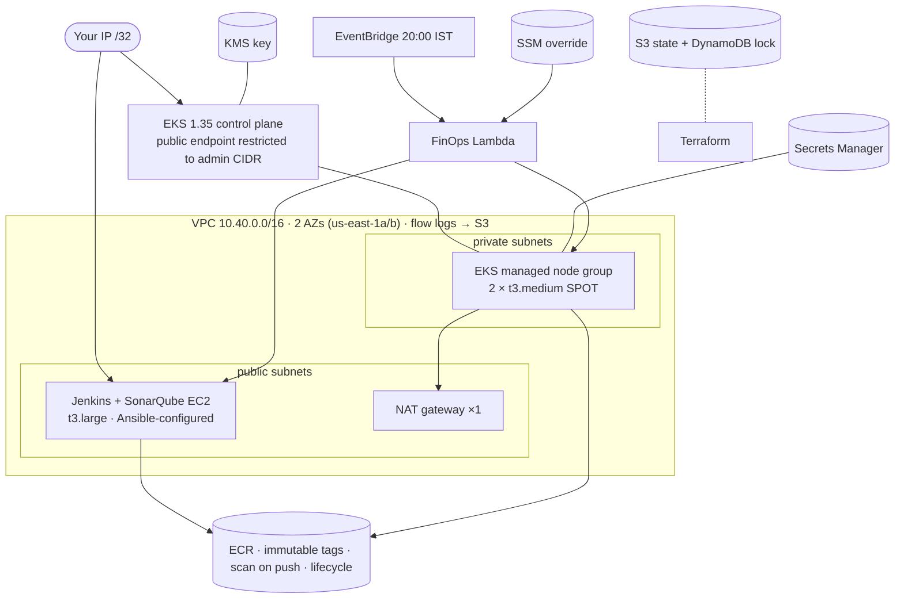

# Architecture

## 1. Design goals
| Goal | How it is met |
|---|---|
| **Secure by default** | Six gates between commit and production (gitleaks, Sonar quality gate, Trivy, Risk Score, Cosign signature, Kyverno admission); runtime is non-root, read-only, default-deny network |
| **Self-healing** | Canary analysis on SLOs with automatic rollback; chaos gate proves recovery on every release |
| **Observable** | Every gate emits metrics (Pushgateway) next to app and cluster metrics; dashboards and alerts are code |
| **Cost-aware** | Local mode costs $0; AWS mode is tagged, small, SPOT, scheduled to sleep, and designed to be destroyed after demos |
| **Reproducible** | Pinned versions (`versions.env`, `requirements*.txt`, image digests); one Makefile; `make verify` |
| **One codebase, two modes** | `MODE=local` (kind, local registry, LocalStack) vs `MODE=aws` (EKS, ECR); differences live only in values/tfvars files |

## 2. Pipeline sequence

## 3. Gates and what each one stops

checkov runs as a **soft** gate: its findings raise the Risk Score instead of failing the build,
so IaC hygiene is weighed against everything else.

## 4. Canary state machine (Feature 3)

Traffic is split by replica count (10 replicas → exact 10 % / 50 %) so no service mesh is needed
(assumption A7). The background analysis queries only canary pods via the
`rollouts-pod-template-hash` label exported by the PodMonitor.

## 5. Local mode (zero cost)

## 6. AWS mode

In AWS Academy, `lab_mode = true` uses the pre-created `LabRole` / `LabInstanceProfile` because
the learner lab cannot create IAM roles or OIDC providers. With `lab_mode = false` the `iam`
module creates dedicated roles and the `eks` module adds the OIDC provider and an IRSA role for
the app ServiceAccount that can read only its own secret.

## 7. Observability data flow
| Source | Collected by | Used in |
|---|---|---|
| App `/metrics` (requests, latency histogram, revision label) | PodMonitor → Prometheus | SLO recording rules, canary analysis, SLO dashboard |
| Pipeline events (start/end, result, lead time, DRS, vulns, chaos) | Jenkins → Pushgateway | DORA recording rules, Command Center |
| Nodes / Kubernetes objects | node-exporter, kube-state-metrics | Cluster Health dashboard, Command Center |
| Argo Rollouts, Kyverno controllers | ServiceMonitors | canary status, admission decisions |
| Alerts | Alertmanager | Telegram / Slack; each alert links to a [runbook](RUNBOOK.md) section |

## 8. Key design decisions
| Decision | Alternative considered | Why |
|---|---|---|
| kind + local registry for local EKS/ECR | LocalStack EKS/ECR | Those are LocalStack Pro (paid) features |
| Cosign **key pair** | Keyless (Fulcio/Rekor + OIDC) | Works offline and identically in kind and EKS; the key is a Jenkins credential |
| Kyverno legacy `ClusterPolicy` for attestations | `ImageValidatingPolicy` | Kyverno 1.19.2's CEL policy requires a Rekor bundle, which offline signing does not produce (see PROGRESS, Phase 5) |
| Replica-based canary | Istio / Linkerd traffic routing | A mesh costs about 2 GB RAM; replica weights are exact with 10 pods |
| kubectl chaos engine (`tools/chaos`) | Chaos Mesh / Litmus | No extra operator or CRDs, same code on kind and EKS; the brief allows a kubectl fallback |
| Pushgateway for pipeline metrics | Jenkins Prometheus plugin | Batch-job semantics; metrics survive Jenkins restarts and carry build labels |
| Dashboards generated from Python | Hand-edited JSON | Tested (unique IDs, no overlap, valid queries, Feature 7 coverage) and diff-friendly |
| GitHub Actions only mirrors `make verify` | Running the full pipeline in Actions | The delivery pipeline needs the cluster; Actions gives a public, independent check and badge |
