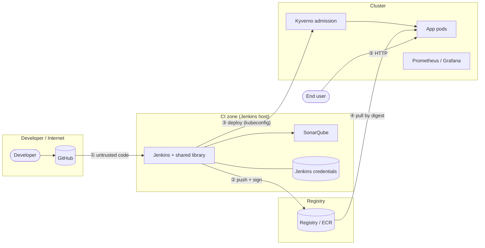

# Threat model (STRIDE)

## Scope and assets
| Asset | Why it matters |
|---|---|
| Source code and history (GitHub) | Everything downstream trusts it |
| Pipeline credentials: Cosign private key, Sonar token, registry and cloud credentials, chat webhooks, Anthropic key | They let an attacker sign, push or deploy as the pipeline |
| Build artifacts: image, SBOM, attestations, reports | They decide what reaches production |
| Kubernetes cluster and the running service | Availability and data of the product |
| AWS account (EKS, ECR, EC2, state bucket) | Cost and blast radius |
| Telemetry (Prometheus, Grafana, alerts) | Hides or reveals an incident |

## Trust boundaries

Every crossing (①-⑤) has at least one control in the table below.

## STRIDE analysis
Status: ✅ implemented and tested · 🟡 partial / environment-dependent · ⬜ accepted risk (out of scope)

### S: Spoofing
| Threat | Control | Status | Where |
|---|---|---|---|
| Attacker pushes an image the pipeline did not build | Cosign signature verified at admission with the pipeline's public key; unsigned images are denied | ✅ `make demo-supply-chain`, `make demo-attack` 4/5 | `k8s/charts/sentinelops-policies/templates/verify-images.yaml` |
| Image swapped behind a tag | Deploy by `@sha256` digest only; Helm render fails on tags; Kyverno requires digests; ECR tags immutable | ✅ helm-lint "tag-pinned image correctly rejected" | `k8s/charts/sentinelops-app/templates/_helpers.tpl`, `terraform/modules/ecr` |
| Image from an untrusted registry | Trusted-registry ValidatingPolicy | ✅ demo-supply-chain | `pod-policies.yaml` |
| Unauthenticated Jenkins / SonarQube access | JCasC: no sign-up, no anonymous read, CSRF crumbs; SonarQube admin password rotated at bootstrap; least-privilege `jenkins-ci` Sonar user | ✅ | `jenkins/image/casc/jenkins.yaml`, `scripts/sonar-bootstrap.sh` |
| Stolen SSH access to the Jenkins EC2 | SG limited to admin /32, sshd hardening (no root, no passwords), fail2ban | ✅ Molecule verify | `ansible/roles/hardening`, `terraform/modules/jenkins-ec2` |

### T: Tampering
| Threat | Control | Status | Where |
|---|---|---|---|
| Malicious or vulnerable dependency | Pinned `==` requirements; Trivy fs + image scan; fixable CRITICAL fails the build; HIGH weighted in DRS | ✅ demo-attack (django 3.2.0 blocked) | `jenkins/shared-library/vars/sentinelTrivyGate.groovy` |
| Compromised build tool (e.g. a backdoored release) | Every tool pinned in `versions.env`; known-bad Trivy releases avoided (see SECURITY-NOTES) | 🟡 versions pinned, binaries not checksum-verified | `versions.env`, `docs/SECURITY-NOTES.md` |
| Image modified after scanning | SBOM and vulnerability scan are **attestations bound to the digest**; Kyverno requires both | ✅ | `require-attestations.yaml` |
| Insecure IaC change (open SG, unencrypted bucket) | checkov on Terraform, Dockerfiles, K8s and Helm; failures raise the DRS; skips documented inline | ✅ 203 passed / 0 failed | `.checkov.yaml`, stage 4 |
| Committed values weaken a guardrail (fault injection left on, analysis disabled, tag image) | Rego guardrails on Helm values (`conftest`) | ✅ `make policy-test` | `policy/rego/helm_values.rego` |
| Terraform state tampering | S3 state: versioning, encryption, public access block, TLS-only; DynamoDB lock | ✅ checkov | `terraform/modules/state-backend` |
| Pipeline definition changed by a PR to skip gates | Gates live in the trusted shared library; Jenkins script security on; review on `main` | 🟡 branch protection must be enabled in GitHub settings | `jenkins/shared-library` |

### R: Repudiation
| Threat | Control | Status | Where |
|---|---|---|---|
| "I didn't deploy that" | Every deployment is a Jenkins build with commit SHA, DRS and digest in the description; Helm + Rollout revision history | ✅ | Jenkins build history, `kubectl argo rollouts get rollout` |
| Artifacts without provenance | Signed SLSA v1 provenance attestation (commit, builder, build URL, inputs) on every image; `make provenance-check` | 🟡 generated and verifiable, not yet enforced at admission (see [SLSA.md](SLSA.md)) | `tools/provenance`, stage 10 |
| AWS actions not traceable | CloudTrail (account default), VPC flow logs to S3, everything tagged `ManagedBy=terraform` | 🟡 CloudTrail depends on the account | `terraform/modules/vpc` |

### I: Information disclosure
| Threat | Control | Status | Where |
|---|---|---|---|
| Secret committed to git | gitleaks on full history in stage 1, in GitHub Actions and in `make secrets-scan`; any secret also scores DRS 100 | ✅ build #24 blocked; demo-attack | `.gitleaks.toml`, stage 1 |
| Secrets in build logs | `withCredentials` masking; `set +x` around secret use; curl credentials via stdin config, not argv | ✅ | Jenkinsfile, `scripts/sonar-bootstrap.sh` |
| Secrets sent to the AI explainer | Redaction (known token formats, private keys, URL credentials, key=value assignments, literal secret env values) **before** any API call; 27 explainer tests | ✅ | `tools/explain/redact.py` |
| Secrets in the cluster | Kubernetes Secrets for chat credentials; AWS Secrets Manager (KMS) for app secrets; IRSA scopes access to one secret | ✅ / 🟡 IRSA only with `lab_mode=false` | `terraform/envs/aws/main.tf` |
| Data exfiltration from a compromised pod | NetworkPolicy: ingress on 8000 only, egress DNS only; no service-account token mounted | 🟡 needs a NetworkPolicy-enforcing CNI (kindnet in kind ≥ 0.24; VPC CNI with network policy enabled on EKS) | `templates/extras.yaml` |

### D: Denial of service
| Threat | Control | Status | Where |
|---|---|---|---|
| Bad release takes the service down | Canary 10 % → 50 % with Prometheus analysis; auto-rollback on SLO breach | ✅ `make demo-canary` | `templates/analysistemplate.yaml` |
| Pod or node loss | 10 replicas, PodDisruptionBudget 50 %, readiness/liveness probes; chaos gate proves recovery on every release | ✅ 9.7 s recovery | `tools/chaos` |
| Noisy neighbour / resource exhaustion | Memory limits required by policy; CPU/memory requests and limits set in the chart | ✅ | `pod-policies.yaml` |
| Error budget silently consumed | Multi-window burn-rate alerts (14.4× and 6×) | ✅ promtool tests | `monitoring/prometheus/sentinelops-slo.rules.yaml` |
| Cost exhaustion (denial of wallet) | Small/SPOT instances, tags, FinOps autopilot, Infracost, typed-confirmation apply/destroy | ✅ | `terraform/modules/finops` |
| Application-layer flooding | No rate limiting in the app | ⬜ accepted for the demo service; add an ingress rate limit or WAF in production | — |

### E: Elevation of privilege
| Threat | Control | Status | Where |
|---|---|---|---|
| Container escape via root | Distroless non-root image (UID 65532); Kyverno denies root, privileged containers, privilege escalation and writable root FS; the chart also drops ALL capabilities and sets seccomp RuntimeDefault | ✅ demo-attack (root pod denied) | `docker/Dockerfile`, `pod-policies.yaml` |
| Pipeline credential abuse | Jenkins credentials scoped to the steps that need them; Sonar token belongs to a least-privilege user; the Jenkins container drops to the `jenkins` user | ✅ | Jenkinsfile, `jenkins/image/entrypoint.sh` |
| Jenkins host has Docker socket access (root-equivalent) | Accepted for local mode; on AWS, Jenkins runs on its own hardened EC2 with an admin-only SG | 🟡 | `local/docker-compose.yml` |
| Over-privileged cloud roles | `lab_mode=false`: dedicated least-privilege roles + IRSA. Learner Lab forces the broad `LabRole` | 🟡 environment constraint | `terraform/modules/iam` |
| Admission bypass by excluding a namespace | Policies enforce on namespaces labelled `sentinelops.io/enforce=true`; Kyverno failure policy fails closed for those | ✅ | `k8s/charts/sentinelops-policies` |

## Residual risks and next steps
1. Enforce the SLSA provenance attestation at admission (builder id + source repository).
2. Verify downloaded tool binaries against published checksums in `scripts/install-tools.sh`.
3. Enable GitHub branch protection (required review + the `verify` check) on `main`.
4. Move the Cosign key to AWS KMS (`cosign generate-key-pair --kms awskms://...`) in AWS mode.
5. Enable network-policy enforcement in the EKS VPC CNI add-on.
6. Add ingress rate limiting / AWS WAF in front of the service for internet exposure.
